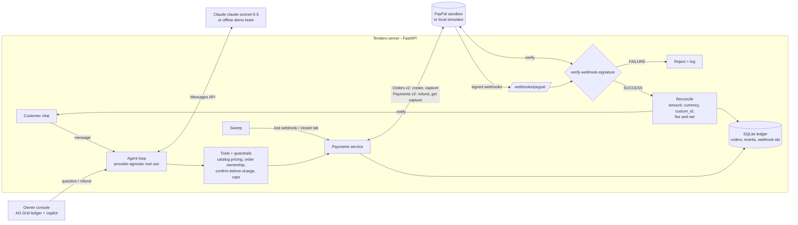

# Tendero

**An AI sales agent that sells, collects and reconciles payments with PayPal for small shops that sell over chat.**

A customer messages the shop. The agent finds the products and prices the cart with tools, then sends a PayPal checkout once the customer confirms the total. It only tells the customer "paid" after PayPal's signed webhook has been verified and reconciled against the order. The owner gets a live ledger and a copilot that can answer "how did we do today?" and issue refunds through PayPal.

Built for the [PayPal AI Hackathon 2026](https://paypalaihackathon.devpost.com/). License: MIT.


---

## The problem

Across Latin America, a large share of small businesses (workshops, bakeries, makers who ship abroad) sell mostly through chat. A typical day for the owner:

1. answers every "how much?" message by hand, often hours later;
2. types totals from memory and sends a payment link for each order;
3. opens the PayPal app to guess which incoming payment belongs to which chat;
4. trusts "I already paid" screenshots, because checking every one takes too long.

Sales are lost at night, totals get mistyped, and nobody reconciles anything. Tendero automates the whole loop, **sell → collect → verify → reconcile → notify**, and the money parts are enforced in code, not in the prompt.

## What it does

| | |
|---|---|
| **Sells in chat** | Customer agent with tools: `search_catalog`, `build_cart`, `create_payment_link`, `get_order_status`, `store_info`. Replies in the customer's language. |
| **Collects with PayPal** | Creates a PayPal order (Orders v2, `intent: CAPTURE`, items + breakdown, `custom_id`/`invoice_id` = our order id, `PayPal-Request-Id` idempotency). The chat shows a *Pay with PayPal* button; after the buyer approves, we capture. |
| **Verifies** | Every webhook is checked with `POST /v1/notifications/verify-webhook-signature`. Unsigned or forged events are rejected and logged, and they change nothing. |
| **Reconciles** | `PAYMENT.CAPTURE.COMPLETED` is matched to the order (status, amount, currency, custom_id). The PayPal fee and net come from `seller_receivable_breakdown`. Amounts that don't match go to `MISMATCH` for human review. |
| **Notifies** | The customer gets a deterministic confirmation in the chat (no LLM text for money facts). The owner's console updates live: AG Grid ledger, KPIs and payment timeline. |
| **Owner copilot** | Merchant agent with `list_orders`, `reconciliation_report`, `refund_order` (Payments v2 refund → verified `PAYMENT.CAPTURE.REFUNDED` → customer notified). |
| **Safety nets** | A sweep re-reads captures from the PayPal API if a webhook is lost. `CHECKOUT.ORDER.APPROVED` triggers an auto-capture if the buyer closes the tab before returning. Duplicate webhooks are ignored (idempotent by event id). |

### Guardrails that live in code (so they hold with any model)

- The LLM never computes money. `build_cart` prices from the catalog, and `create_payment_link` re-prices right before calling PayPal.
- **No charge in the same turn the cart was priced.** The customer must see the total and answer first. If a model tries to skip that step, the tool refuses (there's a test for this).
- Per-order cap (`MAX_ORDER_TOTAL`). Orders belong to the conversation that created them.
- `PAID` can only be set by a verified webhook or by the sweep reading the capture straight from PayPal. A customer saying "I paid" can't set it, and neither can the model or an unsigned request.

## Demo

- **Video (< 3 min):** `<YouTube link>`
- **Run it yourself in 5 minutes:** see below. It runs fully offline by default (local PayPal sandbox simulator + offline demo brain), and switches to the real PayPal sandbox and Claude when you add keys.

## Architecture



Order state machine:

```
DRAFT -> AWAITING_PAYMENT -> APPROVED -> CAPTURED -> PAID -> REFUNDED
                                                  \-> MISMATCH (human review)      any -> FAILED (declined)
```

| Path | What lives there |
|---|---|
| `tendero/agent/agent.py` | Tool-use loop (max 8 steps, all tool results of a step returned in one message, refusal handling) and system prompts |
| `tendero/agent/llm.py` | `AnthropicProvider` (official SDK, `claude-sonnet-5-5`, effort `low`, server-side refusal fallbacks) and `ScriptedProvider` (offline demo brain) behind one `complete()` interface |
| `tendero/agent/tools.py` | Customer and merchant tools with strict JSON schemas, plus the guardrails |
| `tendero/paypal_client.py` | Async PayPal REST client: OAuth2 token cache, Orders v2, Payments v2, webhook verification |
| `tendero/payments.py` | Lifecycle: link → capture → webhook → reconcile → notify; refunds; sweep |
| `tendero/reconcile.py` | Pure reconciliation rules |
| `mock_paypal/server.py` | Local PayPal sandbox **simulator** with the same endpoints, payload shapes, error names (`ORDER_NOT_APPROVED`, `ORDER_ALREADY_CAPTURED`…) and signed webhooks |
| `tendero/static/` | UI: customer chat, owner console (AG Grid Community), checkout overlay |
| `tests/` | 23 tests: pricing, reconciliation, PayPal client, signature checks, end-to-end chat→payment, forged/duplicate/lost webhooks, closed tab, refunds, provider request shape |
| `video/` | Fully scripted demo-video pipeline (Playwright + edge-tts + ffmpeg) |

## Run it in 5 minutes

Requirements: Python 3.11+.

```bash
git clone <repo-url> tendero && cd tendero
python -m venv .venv
# Windows: .venv\Scripts\activate    macOS/Linux: source .venv/bin/activate
pip install -r requirements.txt
python -m tendero.main
```

Open http://localhost:8000 and try:

1. Customer: `Hi! Do you ship to Madrid? I'd like 2 mate gourds and a bombilla`
2. Customer: `Yes, send me the link` → click **Pay with PayPal** → **Approve & pay**
3. Watch the timeline: capture → webhook verified → reconciled → customer notified
4. Click **Send forged webhook**: it gets rejected and nothing changes
5. Owner copilot: `How did we do today? Any issues?` then `Refund the last order - the gourd arrived cracked`

With no keys at all, the badges in the header say **offline demo** and **local sandbox simulator**.

### Use Claude

```bash
export ANTHROPIC_API_KEY=sk-ant-...        # Windows PowerShell: $env:ANTHROPIC_API_KEY="sk-ant-..."
python -m tendero.main                     # badge shows "Claude · claude-sonnet-5-5"
```

Optional: `ANTHROPIC_MODEL`, `ANTHROPIC_EFFORT` (default `low`), `LLM_PROVIDER=anthropic|scripted|auto`.

### Use the real PayPal sandbox

1. On https://developer.paypal.com → *Apps & Credentials* → **Sandbox** → create an app, then copy the Client ID and Secret.
2. Expose the app publicly so PayPal can send webhooks, e.g. `cloudflared tunnel --url http://localhost:8000` (or deploy with `render.yaml`).
3. Register the webhook (or do it in the dashboard):
   ```bash
   export PAYPAL_CLIENT_ID=... PAYPAL_CLIENT_SECRET=...
   python scripts/sandbox_check.py --register-webhook https://<your-public-url>
   ```
4. Run:
   ```bash
   PAYPAL_MODE=sandbox PUBLIC_BASE_URL=https://<your-public-url> PAYPAL_WEBHOOK_ID=<id> python -m tendero.main
   ```
   Pay with a *sandbox personal* account (Dashboard → Sandbox → Accounts).

`python scripts/sandbox_check.py` checks your credentials end to end (token, create order, approve, capture) without the UI.

All settings are listed in [`.env.example`](.env.example).

### Tests

```bash
pip install -r requirements-dev.txt
pytest -q          # 23 passed
```

## AI tools used

- **Claude API (Anthropic)**: the runtime brain of both agents. Model `claude-sonnet-5-5` through the official `anthropic` Python SDK, using tool use with strict JSON schemas, effort `low` for chat latency, and server-side refusal fallbacks.
- **Claude Code (Anthropic)**: AI pair-programmer used while building the project (code, tests, docs, demo-video pipeline). Every line was reviewed and tested by the author.
- **Microsoft Edge neural TTS** (via the open-source `edge-tts` package): synthetic English voice-over for the demo video.
- **Playwright** (headless Chromium): records the demo video. Not AI, but it's how the video was produced without a human on screen.
- Sponsor tool: **AG Grid Community** for the owner's ledger grid.

## What's next

- WhatsApp Business / Instagram channel adapters (the agent is already channel-agnostic).
- PayPal Pay Later and Venmo as funding sources; Payouts for split payments to makers.
- PayPal Agent Toolkit / MCP server as an alternative tool backend for the merchant copilot.
- Multi-currency catalogs (ARS/BRL/MXN display, USD settlement).

## Notes

- All data in this repo is fictional: the shop "Taller Ñandú", its products and the customer "Lucía" are made up. The simulator never touches real money.
- The local simulator is **not** PayPal. It mirrors the documented REST shapes so the flow can be built, tested and demoed before sandbox credentials exist. The same `PayPalClient` code talks to `api-m.sandbox.paypal.com` when `PAYPAL_MODE=sandbox`.
