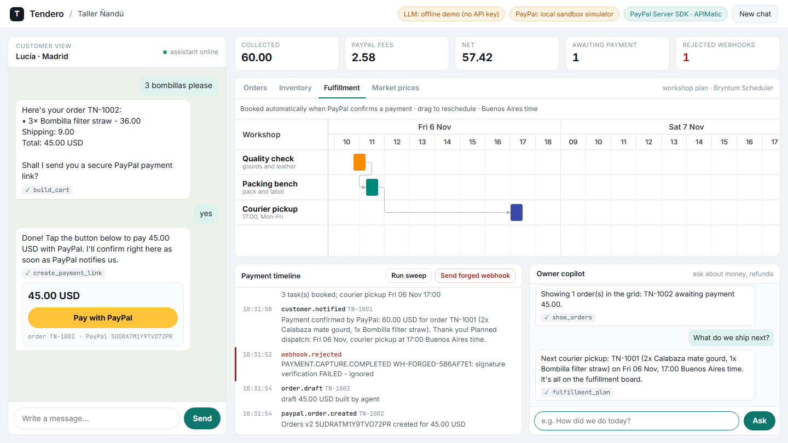
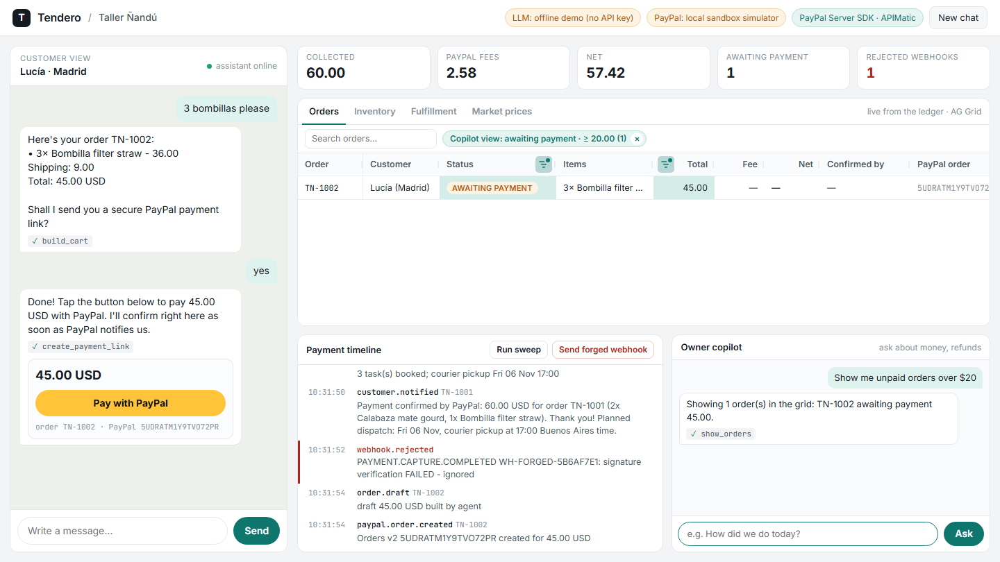
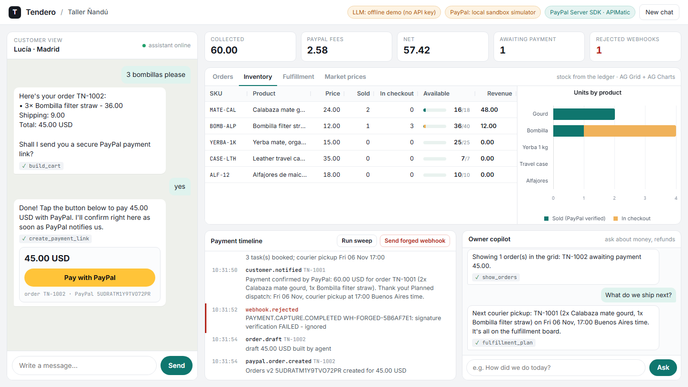
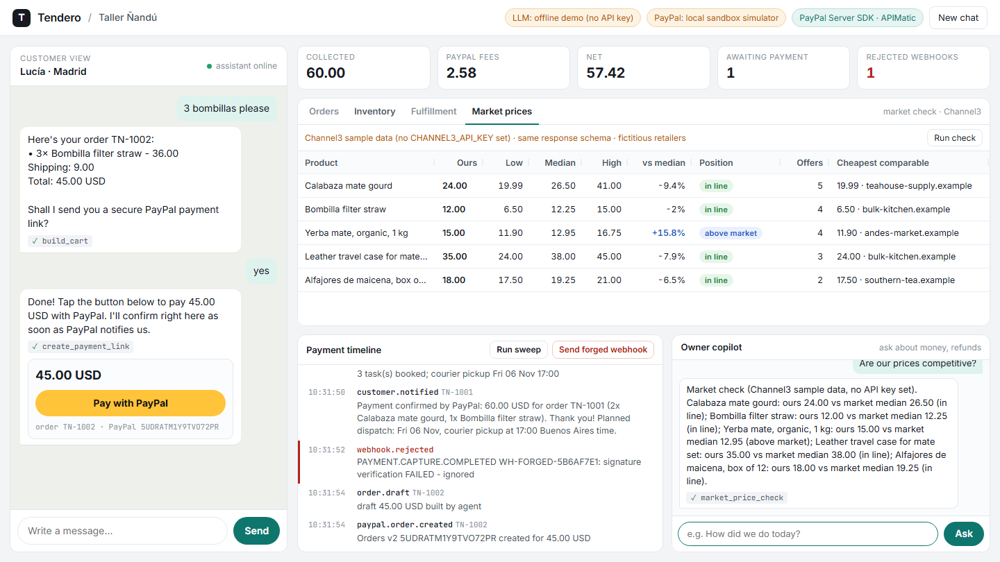
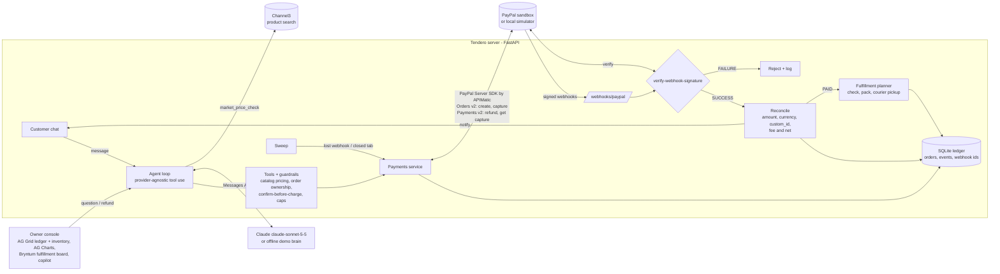

# Tendero

**An AI sales agent that sells, collects and reconciles payments with PayPal for small shops that sell over chat.**

A customer messages the shop. The agent finds the products and prices the cart with tools, then sends a PayPal checkout once the customer confirms the total. It only tells the customer "paid" after PayPal's signed webhook has been verified and reconciled against the order. Then the work is booked in the workshop (check, pack, courier pickup) and the customer gets a dispatch day. The owner gets a live ledger, an inventory view, a fulfillment board, a market price check and a copilot that drives all of it and issues refunds through PayPal.

Built for the [PayPal AI Hackathon 2026](https://paypalaihackathon.devpost.com/). License: MIT.



| Copilot filters the AG Grid ledger | Inventory: AG Grid + AG Charts | Market prices via Channel3 |
|---|---|---|
|  |  |  |

---

## The problem

Across Latin America, a large share of small businesses (workshops, bakeries, makers who ship abroad) sell mostly through chat. A typical day for the owner:

1. answers every "how much?" message by hand, often hours later;
2. types totals from memory and sends a payment link for each order;
3. opens the PayPal app to guess which incoming payment belongs to which chat;
4. trusts "I already paid" screenshots, because checking every one takes too long.

Sales are lost at night, totals get mistyped, and nobody reconciles anything. Tendero automates the whole loop, **sell → collect → verify → reconcile → notify**, and the money parts are enforced in code, not in the prompt.

## What it does

| | |
|---|---|
| **Sells in chat** | Customer agent with tools: `search_catalog`, `build_cart`, `create_payment_link`, `get_order_status`, `store_info`. Replies in the customer's language. |
| **Collects with PayPal** | Creates a PayPal order (Orders v2, `intent: CAPTURE`, items + breakdown, `custom_id`/`invoice_id` = our order id, `PayPal-Request-Id` idempotency). The chat shows a *Pay with PayPal* button; after the buyer approves, we capture. |
| **Verifies** | Every webhook is checked with `POST /v1/notifications/verify-webhook-signature`. Unsigned or forged events are rejected and logged, and they change nothing. |
| **Reconciles** | `PAYMENT.CAPTURE.COMPLETED` is matched to the order (status, amount, currency, custom_id). The PayPal fee and net come from `seller_receivable_breakdown`. Amounts that don't match go to `MISMATCH` for human review. |
| **Notifies** | The customer gets a deterministic confirmation in the chat (no LLM text for money facts), including the planned dispatch day. The owner's console updates live: KPIs, payment timeline and four tabs (Orders, Inventory, Fulfillment, Market prices). |
| **Fulfills** | A verified payment books the work on a **Bryntum Scheduler** board: quality check, packing, courier pickup, with dependencies, workshop hours and courier days enforced by the server. The owner can drag tasks; impossible moves are refused. Refunds take the order off the board. |
| **Owner copilot** | Merchant agent with `list_orders`, `reconciliation_report`, `refund_order` (Payments v2 refund → verified `PAYMENT.CAPTURE.REFUNDED` → customer notified), `show_orders` (filters and sorts the **AG Grid** ledger on screen), `fulfillment_plan` and `market_price_check` (**Channel3** product search). |
| **Safety nets** | A sweep re-reads captures from the PayPal API if a webhook is lost. `CHECKOUT.ORDER.APPROVED` triggers an auto-capture if the buyer closes the tab before returning. Duplicate webhooks are ignored (idempotent by event id). |

### Guardrails that live in code (so they hold with any model)

- The LLM never computes money. `build_cart` prices from the catalog, and `create_payment_link` re-prices right before calling PayPal.
- **No charge in the same turn the cart was priced.** The customer must see the total and answer first. If a model tries to skip that step, the tool refuses (there's a test for this).
- Per-order cap (`MAX_ORDER_TOTAL`). Orders belong to the conversation that created them.
- `PAID` can only be set by a verified webhook or by the sweep reading the capture straight from PayPal. A customer saying "I paid" can't set it, and neither can the model or an unsigned request.

## Demo

- **Video (< 3 min):** `<YouTube link>`
- **Run it yourself in 5 minutes:** see below. It runs without any account by default (local PayPal sandbox simulator + offline demo brain + Channel3 sample data), and switches to the real PayPal sandbox, Claude and live Channel3 search when you add keys.

## Sponsor integrations

Each one does a job in the product; none is there for decoration.

| Sponsor | What Tendero uses | Where it shows up | Code |
|---|---|---|---|
| **AG Grid** | AG Grid Community 36 (Theming API, custom cell renderers, number/text filters, quick filter, cell flash, pinned column) and AG Charts Community 14 | **Orders** ledger that the copilot filters and sorts from chat (`show_orders` → `setFilterModel` / `applyColumnState`); **Inventory** grid with stock bars computed from verified payments, plus a stacked bar chart; **Market prices** grid | `tendero/static/app.js`, `tendero/catalog.py` (`inventory`), `tendero/agent/tools.py` |
| **Bryntum** | Bryntum Scheduler **Community** 8.0 (MIT): resources, events, dependencies, drag & resize, tooltips, a non-continuous time axis (workshop hours only) | **Fulfillment** tab: the work booked after each verified payment. Every drag is validated by the server through `beforeEventDropFinalize` / `beforeEventResizeFinalize` (async finalize) | `tendero/fulfillment.py`, `tendero/static/app.js`, `vendor/` (bundle build) |
| **APIMatic** | The official **PayPal Server SDK** (`paypal-server-sdk`), which APIMatic generates from PayPal's API definition, integrated with the skills of APIMatic's **PayPal Server SDK Context Plugin** for coding agents | Every Orders v2 create/get/capture and Payments v2 get/refund call (typed models such as `OrderRequest`, `PurchaseUnitRequest`, `RefundRequest`; the `ApiResponse` envelope; `ApiException` mapped to our errors). Tests use the SDK's `requests.Session` seam, as the plugin's testing skill recommends | `tendero/paypal_sdk.py`, `tests/test_integrations.py` |
| **Channel3** | `POST /v1/search` with `x-api-key`; offers filtered to in stock, new, same currency | The owner asks "Are our prices competitive?" and gets low / median / high market prices per product next to the shop's price, plus the cheapest comparable offer | `tendero/market.py`, `tendero/data/market_sample.json` |

Without `CHANNEL3_API_KEY` the market check replays a bundled sample response in Channel3's schema (fictitious `.example` retailers), and both the UI and the copilot say it is sample data.

## Architecture



Order state machine:

```
DRAFT -> AWAITING_PAYMENT -> APPROVED -> CAPTURED -> PAID -> REFUNDED
                                                  \-> MISMATCH (human review)      any -> FAILED (declined)
```

| Path | What lives there |
|---|---|
| `tendero/agent/agent.py` | Tool-use loop (max 8 steps, all tool results of a step returned in one message, refusal handling) and system prompts |
| `tendero/agent/llm.py` | `AnthropicProvider` (official SDK, `claude-sonnet-5-5`, effort `low`, server-side refusal fallbacks) and `ScriptedProvider` (offline demo brain) behind one `complete()` interface |
| `tendero/agent/tools.py` | Customer and merchant tools with strict JSON schemas, plus the guardrails |
| `tendero/paypal_client.py` | Async PayPal REST client: OAuth2 token cache, Orders v2, Payments v2, webhook verification |
| `tendero/paypal_sdk.py` | Same interface on top of the APIMatic-generated PayPal Server SDK (default, `PAYPAL_SDK=apimatic`) |
| `tendero/fulfillment.py` | Books check / pack / pickup after a verified payment; validates every move from the board |
| `tendero/market.py` | Channel3 search client and market price summary (live, or clearly labelled sample data) |
| `tendero/payments.py` | Lifecycle: link → capture → webhook → reconcile → notify; refunds; sweep |
| `tendero/reconcile.py` | Pure reconciliation rules |
| `mock_paypal/server.py` | Local PayPal sandbox **simulator** with the same endpoints, payload shapes, error names (`ORDER_NOT_APPROVED`, `ORDER_ALREADY_CAPTURED`…) and signed webhooks |
| `tendero/static/` | UI: customer chat, owner console (AG Grid, AG Charts, Bryntum Scheduler), checkout overlay. `static/vendor/bryntum/` is the prebuilt Scheduler Community bundle (MIT) |
| `vendor/` | How that bundle is built (`npm ci && npm run build`); only needed to rebuild it |
| `tests/` | 36 tests: pricing, reconciliation, PayPal REST client and Server SDK (request shape, error mapping), signature checks, end-to-end chat→payment, forged/duplicate/lost/early webhooks, closed tab, refunds, fulfillment planning and move validation, copilot grid views, inventory, Channel3 parsing and sample mode |
| `video/` | Fully scripted demo-video pipeline (Playwright + edge-tts + ffmpeg) |

## Run it in 5 minutes

Requirements: Python 3.11+.

```bash
git clone <repo-url> tendero && cd tendero
python -m venv .venv
# Windows: .venv\Scripts\activate    macOS/Linux: source .venv/bin/activate
pip install -r requirements.txt
python -m tendero.main
```

Open http://localhost:8000 and try:

1. Customer: `Hi! Do you ship to Madrid? I'd like 2 mate gourds and a bombilla`
2. Customer: `Yes, send me the link` → click **Pay with PayPal** → **Approve & pay**
3. Watch the timeline: capture → webhook verified → reconciled → customer notified
4. Click **Send forged webhook**: it gets rejected and nothing changes
5. Owner copilot: `How did we do today? Any issues?` then `Refund the last order - the gourd arrived cracked`

With no keys at all, the badges in the header say **offline demo** and **local sandbox simulator**.

### Use Claude

```bash
export ANTHROPIC_API_KEY=sk-ant-...        # Windows PowerShell: $env:ANTHROPIC_API_KEY="sk-ant-..."
python -m tendero.main                     # badge shows "Claude · claude-sonnet-5-5"
```

Optional: `ANTHROPIC_MODEL`, `ANTHROPIC_EFFORT` (default `low`), `LLM_PROVIDER=anthropic|scripted|auto`.

### Live market prices (Channel3)

Create a free developer key at https://channel3.ai and set `CHANNEL3_API_KEY`. The Market prices tab and the copilot switch from sample data to live search.

### Use the real PayPal sandbox

1. On https://developer.paypal.com → *Apps & Credentials* → **Sandbox** → create an app, then copy the Client ID and Secret.
2. Expose the app publicly so PayPal can send webhooks, e.g. `cloudflared tunnel --url http://localhost:8000` (or deploy with `render.yaml`).
3. Register the webhook (or do it in the dashboard):
   ```bash
   export PAYPAL_CLIENT_ID=... PAYPAL_CLIENT_SECRET=...
   python scripts/sandbox_check.py --register-webhook https://<your-public-url>
   ```
4. Run:
   ```bash
   PAYPAL_MODE=sandbox PUBLIC_BASE_URL=https://<your-public-url> PAYPAL_WEBHOOK_ID=<id> python -m tendero.main
   ```
   Pay with a *sandbox personal* account (Dashboard → Sandbox → Accounts).

`python scripts/sandbox_check.py` checks your credentials end to end (token, create order, approve, capture) without the UI.

All settings are listed in [`.env.example`](.env.example).

### Tests

```bash
pip install -r requirements-dev.txt
pytest -q          # 36 passed
```

## AI tools used

- **Claude API (Anthropic)**: the runtime brain of both agents. Model `claude-sonnet-5-5` through the official `anthropic` Python SDK, using tool use with strict JSON schemas, effort `low` for chat latency, and server-side refusal fallbacks.
- **Claude Code (Anthropic)**: AI pair-programmer used while building the project (code, tests, docs, demo-video pipeline). Every line was reviewed and tested by the author.
- **Microsoft Edge neural TTS** (via the open-source `edge-tts` package): synthetic English voice-over for the demo video.
- **Playwright** (headless Chromium): records the demo video. Not AI, but it's how the video was produced without a human on screen.
- Sponsor tools: **AG Grid** (Community grid + AG Charts), **Bryntum** Scheduler Community, the **PayPal Server SDK generated by APIMatic** (with APIMatic's Context Plugin for coding agents), **Channel3** product search. Details in [Sponsor integrations](#sponsor-integrations).

## What's next

- WhatsApp Business / Instagram channel adapters (the agent is already channel-agnostic).
- PayPal Pay Later and Venmo as funding sources; Payouts for split payments to makers.
- PayPal Agent Toolkit / MCP server as an alternative tool backend for the merchant copilot.
- Courier tracking numbers sent to PayPal (Orders v2 trackers) when a pickup happens; AG Studio dashboards for the owner.
- Multi-currency catalogs (ARS/BRL/MXN display, USD settlement).

## Notes

- All data in this repo is fictional: the shop "Taller Ñandú", its products and the customer "Lucía" are made up. The simulator never touches real money.
- Third-party code shipped in this repo: `tendero/static/vendor/bryntum/` (Bryntum Scheduler Community, MIT, see its `LICENSE`; Font Awesome Free icons, CC BY 4.0 / SIL OFL 1.1 / MIT, see the CSS headers). AG Grid and AG Charts Community (MIT) load from jsDelivr.
- The local simulator is **not** PayPal. It mirrors the documented REST shapes so the flow can be built, tested and demoed before sandbox credentials exist. The same `PayPalClient` code talks to `api-m.sandbox.paypal.com` when `PAYPAL_MODE=sandbox`.
